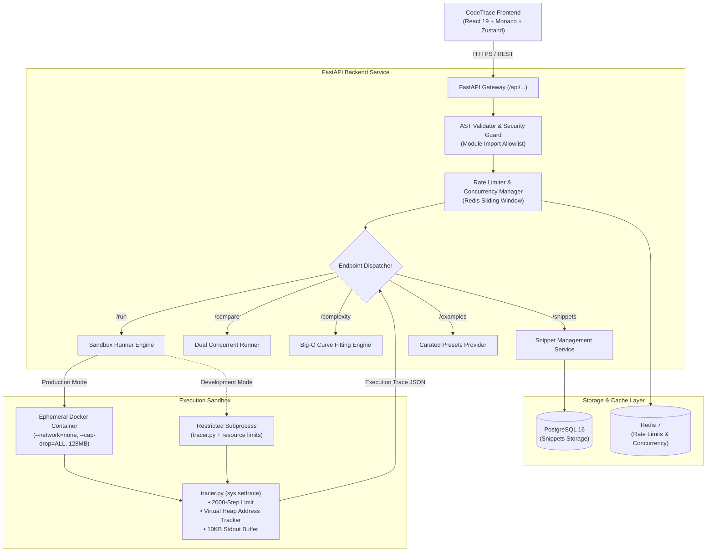

# CodeTrace

<div align="center">


**Interactive Step-by-Step Python Execution Tracer, Virtual Heap Visualizer & Empirical Complexity Profiler**

[](https://www.python.org/)
[](https://fastapi.tiangolo.com/)
[](https://react.dev/)
[](https://www.typescriptlang.org/)
[](https://vitejs.dev/)
[](https://www.docker.com/)
[](#testing--verification)
[](LICENSE)

[Features](#key-features) • [Architecture](#architecture) • [Quick Start](#quick-start) • [API Reference](#api-specification) • [Testing](#testing--verification) • [Security](#security--sandbox-model)

</div>

---

## Overview

**CodeTrace** is a developer tool and educational platform designed to eliminate the cognitive load of mental execution and messy `print()` debugging. By compiling and running arbitrary Python 3.12 code inside an isolated sandbox, CodeTrace reconstructs execution step-by-step:

- Inspect local and global frame bindings without raw hex pointer noise.
- Visualize container mutations and reference topologies inside an interactive Virtual Heap.
- Scrub back and forth across execution timelines with variable-speed replays.
- Empirically profile time and space algorithmic complexity with AST-guided curve fitting.

Whether you're debugging intricate recursive backtracking, demystifying pointer aliasing, or comparing two sorting algorithms side-by-side, CodeTrace gives you deep visibility into every line of code.

---

## Key Features

### 🔍 Deterministic Step-by-Step Tracing
- Powered by a custom Python trace engine (`sys.settrace`) that captures line transitions, local variable assignments, function calls, returns, and standard output streams.
- Up to **2,000 steps** per execution with automated truncation safeguards.
- Interactive timeline scrubber with forward/backward step controls, auto-play, and playback speed adjustments (`0.5x` to `4x`).

### 🧠 Smart Variables & Virtual Heap
- **Readable Value Previews**: Primitives render cleanly (Python `None`, `True`, `False`), while lists, dicts, sets, and tuples display concise previews (`[2, 8, 11, ...]`, `{'a': 1, 'b': 2}`).
- **Stable Reference Tags**: Replaces raw memory addresses (`0x7f9...`) with human-friendly, deterministic heap references (`@1`, `@2`, `@3`) that remain stable across the entire replay.
- **Dedicated Virtual Heap Inspector**: Dedicated inspection cards for mutable objects, featuring indexed list cells, dictionary key-value rows, and instance attribute mappings.

### 📈 Empirical Big-O Complexity Profiler
- **Live Empirical Benchmarking**: Automatically executes functions across progressive input sizes ($N \in [5, 10, 20, 40, 80, \dots]$) using customizable input generators (`array`, `sorted_array`, `reverse_sorted`, `matrix`, `integer`, `string`) across `best`, `average`, and `worst` cases.
- **Multi-Model Curve Fitting**: Combines normalized least-squares error and log-log slope regression across 7 standard Big-O classes:
  $$\mathcal{O}(1), \quad \mathcal{O}(\log n), \quad \mathcal{O}(n), \quad \mathcal{O}(n \log n), \quad \mathcal{O}(n^2), \quad \mathcal{O}(n^3), \quad \mathcal{O}(2^n)$$
- **AST Heuristic Guidance**: Detects loop depths, recursive branching, and built-in optimized helpers (such as Timsort via `sorted()`).
- Real-time interactive scatter plots and fitted regression curves rendered with Recharts. Results are clearly designated as **Estimated** with confidence metrics.

### 🔀 Dual Comparison Mode
- Benchmark two distinct implementations side-by-side in real time (e.g., Quick Sort vs. Bubble Sort, or Memoized vs. Naive Fibonacci).
- Synchronized step counters, execution line comparisons, and total operation differentials.

### 🎯 Predict Mode (Active Recall)
- Interactive learning mode that halts before executing each line, prompting users to predict variable mutations and line jumps before revealing the next trace step.

### 🛡️ Multi-Layer Zero-Trust Sandboxing
- Multi-tier defensive architecture enforcing AST import allowlisting, process timeouts, memory ceilings, and containerized kernel isolation.

### 🔗 Snippet Persistence & Sharing
- Persist code snippets to PostgreSQL and generate unique short URLs to share reproducible execution traces with teammates or students.

---

## Architecture



---

## Tech Stack

| Domain | Technologies & Libraries |
| :--- | :--- |
| **Frontend** | React 19, TypeScript 5, Vite 6, Tailwind CSS, Monaco Editor (`@monaco-editor/react`), Recharts, Zustand, Framer Motion, Lucide Icons |
| **Backend** | Python 3.12, FastAPI, Pydantic v2, SQLAlchemy 2 (async), Alembic, Docker SDK, Structlog |
| **Data & Cache** | PostgreSQL 16 (production snippets), SQLite via `aiosqlite` (local fallback), Redis 7 (rate limiting) |
| **Sandbox** | Docker Engine API, `sys.settrace`, Linux Kernel cgroups, AST parser |
| **Testing** | Pytest, Vitest, Playwright (Chromium E2E), Testing Library, MSW |

---

## Quick Start

### Option 1: Docker Compose (Recommended)

The fastest way to spin up the entire stack (FastAPI backend, PostgreSQL, Redis, and worker environment):

```bash
# 1. Clone the repository
git clone https://github.com/Alex-2006-alt/Code-visualizer.git
cd Code-visualizer

# 2. Build and launch services
docker compose up --build
```

- **Backend API**: `http://localhost:8000`
- **Interactive API Docs (Swagger UI)**: `http://localhost:8000/docs`
- **PostgreSQL**: `localhost:5432`
- **Redis**: `localhost:6379`

In another terminal, start the frontend:
```bash
cd frontend
npm install
npm run dev
```
Open `http://localhost:5173` in your browser.

---

### Option 2: Manual Local Setup

#### Prerequisites
- **Python**: 3.12 or higher
- **Node.js**: 20.x or higher (`npm` 10+)
- **Redis** & **PostgreSQL** (optional; SQLite fallback enabled by default)

#### 1. Backend Setup
```bash
# Navigate to backend directory
cd backend

# Create and activate virtual environment
python -m venv .venv

# On Windows:
.venv\Scripts\activate
# On Linux / macOS:
source .venv/bin/activate

# Install dependencies
pip install -r requirements.txt -r requirements-dev.txt

# Configure environment variables
cp .env.example .env

# Run database migrations
alembic upgrade head

# Launch FastAPI development server
uvicorn app.main:app --host 127.0.0.1 --port 8000 --reload
```

#### 2. Frontend Setup
```bash
# Navigate to frontend directory
cd frontend

# Install dependencies
npm install

# Configure environment variables
cp .env.example .env

# Launch Vite development server
npm run dev
```

Visit `http://localhost:5173` to start visualizing code.

---

## API Specification

All endpoints are served with and without the `/api` prefix for flexible reverse proxy routing:

| Method | Endpoint | Description | Request Body Excerpt | Response Highlights |
| :--- | :--- | :--- | :--- | :--- |
| `GET` | `/api/health` | Service health & uptime probe | None | `{"status": "ok"}` |
| `POST` | `/api/run` | Execute Python code & generate trace | `{"code": "...", "stdin": ""}` | Full step-by-step trace frames, heap maps, stdout |
| `POST` | `/api/complexity` | Empirical Big-O estimation & curve fitting | `{"code": "...", "function_name": "...", "input_kind": "array", "case": "average"}` | Data points, fitted Big-O label (`O(n)`), confidence score, AST notes |
| `POST` | `/api/compare` | Concurrently trace two code blocks | `{"code_a": "...", "code_b": "..."}` | Dual trace outputs, side-by-side step counts |
| `POST` | `/api/snippets` | Save snippet & generate permalink ID | `{"code": "...", "title": "..."}` | `{"id": "a1b2c3d4"}` |
| `GET` | `/api/snippets/{id}`| Retrieve shared snippet by ID | None | `{"id", "code", "title", "created_at"}` |
| `GET` | `/api/examples` | Curated algorithm preset collection | None | Array of curated algorithm presets |

---

## Security & Sandbox Model

CodeTrace treats all submitted user code as untrusted. Execution is guarded through multiple defensive rings:

1. **AST Static Analysis & Module Allowlists**:
   - Before execution, code is parsed into an Abstract Syntax Tree (AST).
   - Only safe, pure-computational modules are permitted:
     `math`, `random`, `collections`, `itertools`, `heapq`, `bisect`, `functools`, `string`, `re`, `typing`.
   - Access to `os`, `sys`, `subprocess`, `socket`, `builtins.open`, `importlib`, and dunder attribute probing (`__subclasses__`) is immediately blocked.

2. **Isolated Container Sandbox (Production)**:
   - Built on a hardened, stripped scratch image (`codetrace-sandbox`).
   - `--network=none`: Total network isolation; prevents external sockets and exfiltration.
   - `--cap-drop=ALL` & `--security-opt=no-new-privileges`: Kernel capabilities stripped.
   - Read-only root filesystem with an ephemeral 16 MB `/tmp` `tmpfs`.
   - Resource quotas: **128 MB RAM** (swap disabled), **0.5 CPU quota**, and max **64 PIDs** (prevents fork bombs).
   - Hard **5.0-second** wall-clock execution limit enforced with `SIGKILL`.

3. **Runtime Guardrails (`tracer.py`)**:
   - Execution step limit capped at **2,000 steps** (`truncated: true`).
   - Output buffer capped at **10 KB** to prevent memory exhaustion.
   - Reference inspection tracks object pointers (`id()`) with recursion depth caps.

---

## Testing & Verification

CodeTrace enforces strict test coverage across unit, component, integration, and end-to-end browser layers.

### Run Backend Unit & Integration Tests (Pytest)
```bash
pytest backend/tests -v
```
*Covers AST security validation, runner sandboxing, curve fitting regression, snippet persistence, and rate limiting.*

### Run Frontend Unit & Component Tests (Vitest)
```bash
cd frontend
npm run test
```
*Covers formatters, friendly reference labels, virtual heap rendering, Zustand store state transitions, and Monaco synchronization.*

### Run End-to-End Tests (Playwright)
```bash
# Run real browser integration tests against the live stack
node tests-e2e/test_regression_editor_truth.cjs
node tests-e2e/test_display_and_complexity.cjs
```
*Validates editor-to-trace integrity, custom code execution, and empirical complexity plots in headless Chromium.*

### Code Quality & Static Analysis
```bash
# Backend linting & type checks
ruff check backend
mypy --config-file backend/pyproject.toml backend/app backend/sandbox

# Frontend linting & type checks
cd frontend
npm run lint
npm run typecheck
```

---

## Environment Configuration

### Backend (`backend/.env`)

| Variable | Default | Description |
| :--- | :--- | :--- |
| `APP_ENV` | `development` | Environment mode (`development`, `production`, `test`) |
| `APP_DEBUG` | `false` | Enable verbose logging |
| `APP_PORT` | `8000` | FastAPI server port |
| `CORS_ORIGINS` | `["http://localhost:5173"]` | Authorized frontend origins |
| `DATABASE_URL` | `sqlite+aiosqlite:///./codetrace.db` | Async SQLAlchemy database connection |
| `REDIS_URL` | `redis://localhost:6379/0` | Redis connection for rate limiting |
| `SANDBOX_RUNNER_TYPE` | `subprocess` | Sandbox driver: `docker` (production) or `subprocess` (local dev) |
| `SANDBOX_TIMEOUT_SECONDS` | `5` | Maximum execution time in seconds |
| `SANDBOX_MAX_STEPS` | `2000` | Maximum recorded trace steps |
| `RATE_LIMIT_PER_MINUTE` | `20` | Max trace executions per client IP per minute |

### Frontend (`frontend/.env`)

| Variable | Default | Description |
| :--- | :--- | :--- |
| `VITE_API_URL` | `http://localhost:8000` | Backend API base URL |
| `VITE_USE_MOCKS` | `false` | Enable canned offline mocks (development only) |

---

## Project Structure

```text
Code-visualizer/
├── backend/
│   ├── app/
│   │   ├── routes/             # FastAPI endpoint routers (run, complexity, compare, snippets)
│   │   ├── services/           # Business logic (complexity curve fitting, runner dispatch)
│   │   ├── models/             # SQLAlchemy database models
│   │   ├── schemas.py          # Pydantic v2 request/response contracts
│   │   └── config.py           # Environment configuration & settings
│   ├── sandbox/
│   │   ├── tracer.py           # sys.settrace engine & heap address tracking
│   │   ├── runner.py           # Subprocess & Docker sandbox executor
│   │   ├── security.py         # AST inspection & import allowlist validation
│   │   └── Dockerfile          # Hardened zero-trust sandbox image
│   └── tests/                  # Pytest unit & integration test suite
├── frontend/
│   ├── src/
│   │   ├── components/
│   │   │   ├── workspace/      # Editor, VariablesTable, MemoryHeap, ComplexityMeter, TimelineBar
│   │   │   ├── compare/        # Dual-code comparison workspace
│   │   │   └── predict/        # Active recall prediction quiz interface
│   │   ├── lib/                # API client, value formatters, reference label generator
│   │   ├── stores/             # Zustand global execution & replay stores
│   │   └── types/              # TypeScript interface definitions for traces & heap
│   └── src/test/               # Vitest component & store unit test suite
├── tests-e2e/                  # Playwright browser automation test suite
├── docker-compose.yml          # Multi-container orchestration (API, Postgres, Redis)
└── README.md                   # Project documentation
```

---

## Contributing

Contributions are what make the open-source community an incredible place to learn, inspire, and create. Any contributions you make are **greatly appreciated**.

1. Fork the Project
2. Create your Feature Branch (`git checkout -b feature/AmazingFeature`)
3. Commit your Changes (`git commit -m 'feat: Add AmazingFeature'`)
4. Ensure All Tests Pass (`pytest backend/tests && npm run test`)
5. Push to the Branch (`git push origin feature/AmazingFeature`)
6. Open a Pull Request

---

## License

Distributed under the MIT License. See `LICENSE` for more information.
