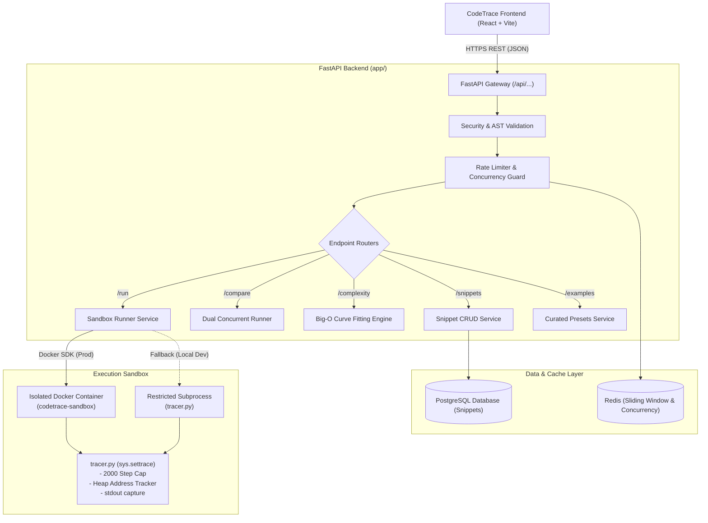

# CodeTrace Backend

High-performance, secure Python execution trace engine and REST API powering CodeTrace.

## Architecture Overview



---

## Security Model & Hardened Isolation

CodeTrace executes arbitrary user Python code inside zero-trust throwaway sandboxes with multi-layered containment:

1. **Kernel & Container Constraints (Production / Docker):**
   - **Network Disabled:** `--network=none` prevents data exfiltration and external socket access.
   - **Read-Only Root Filesystem:** Prevents filesystem tampering.
   - **Ephemeral tmpfs:** Limited `/tmp` (16 MB) for transient execution artifacts.
   - **Dropped Capabilities:** `--cap-drop=ALL` strips all Linux kernel capabilities.
   - **No New Privileges:** Prevents privilege escalation.
   - **Resource Quotas:**
     - Memory: `128 MB` with swap strictly disabled.
     - CPU: `0.5` quota limit.
     - PIDs Limit: `64` prevents fork bombs.
     - Wall-clock timeout: Hard `5.0-second` timeout with forced `SIGKILL` and container cleanup in a `finally` block.

2. **AST Static Analysis & Import Allowlist:**
   - Pre-execution AST scan rejects unauthorized module imports before any code is fed to the runner.
   - **Allowed Modules:** `math`, `random`, `collections`, `itertools`, `heapq`, `bisect`, `functools`, `string`, `re`, `typing`.
   - **Prohibited Modules:** `os`, `sys`, `subprocess`, `socket`, `shutil`, built-in `open()`, etc.

3. **Runtime Tracer Guardrails (`tracer.py`):**
   - Step limit: Automatically truncates after `2000` steps (`truncated: true`).
   - Output limit: Stdout capped at `10 KB` per run to prevent memory exhaustion.
   - Heap reference tracker: Maps object pointers (`id()`) with recursion depth limit of 2 and collection cap of 50 items.

---

## API Specification

All endpoints are available at root and with the `/api` prefix for maximum frontend compatibility:

| Method | Endpoint | Description | Request Body | Response |
| :--- | :--- | :--- | :--- | :--- |
| `GET` | `/health`, `/api/health` | Health check & uptime | None | `{"status": "ok"}` |
| `POST` | `/run`, `/api/run` | Execute code & capture step trace | `{"code": str, "stdin"?: str}` | `RunResponse` (`steps`, `truncated`, `error`) |
| `POST` | `/compare`, `/api/compare` | Concurrently run and compare two codes | `{"code_a": str, "code_b": str, "stdin"?: str}` | `{"a": ..., "b": ..., "step_counts": {...}}` |
| `POST` | `/complexity`, `/api/complexity` | Analyze time complexity across sizes | `{"code": str, "function_name": str, "sizes": [int]}` | `{"points": [{"n", "ops"}], "label": "O(n)"}` |
| `POST` | `/snippets`, `/api/snippets` | Save snippet & generate share ID | `{"code": str, "title"?: str}` | `{"id": "abc12345"}` |
| `GET` | `/snippets/{id}`, `/api/snippets/{id}` | Retrieve snippet by ID | None | `{"id", "code", "title", "created_at"}` |
| `GET` | `/examples`, `/api/examples` | Fetch curated algorithm presets | None | Array of `ExampleSchema` |

---

## Environment Variables

| Variable | Type | Default | Description |
| :--- | :--- | :--- | :--- |
| `APP_ENV` | `str` | `development` | Environment mode (`development`, `production`, `test`) |
| `APP_DEBUG` | `bool` | `false` | Enable verbose debug logging |
| `APP_HOST` | `str` | `0.0.0.0` | API bind address |
| `APP_PORT` | `int` | `8000` | API bind port |
| `CORS_ORIGINS` | `list[str]` | `["http://localhost:5173", "http://localhost:3000"]` | Allowed CORS origins for frontend |
| `DATABASE_URL` | `str` | `sqlite+aiosqlite:///./codetrace.db` | Async SQLAlchemy database connection URL |
| `REDIS_URL` | `str` | `redis://localhost:6379/0` | Redis connection URL for rate limiting |
| `RATE_LIMIT_PER_MINUTE` | `int` | `20` | Max requests per IP per minute |
| `RATE_LIMIT_PER_DAY` | `int` | `500` | Max requests per IP per day |
| `MAX_CONCURRENT_RUNS` | `int` | `10` | Global concurrency cap before returning 503 |
| `MAX_CODE_SIZE_BYTES` | `int` | `10240` | Maximum allowed code size in bytes (10 KB) |
| `SANDBOX_TIMEOUT_SECONDS`| `int` | `5` | Maximum execution time before termination |
| `SANDBOX_MAX_STEPS` | `int` | `2000` | Maximum execution steps captured |
| `SANDBOX_RUNNER_TYPE` | `str` | `docker` | Runner engine: `docker` or `subprocess` (dev) |
| `SANDBOX_DOCKER_IMAGE` | `str` | `codetrace-sandbox:latest` | Tag of the minimal sandbox container image |

---

## Local Development Setup

### Option 1: Direct Python (No Docker Required)

1. Navigate to the backend directory:
   ```bash
   cd backend
   ```
2. Create and activate a virtual environment:
   ```bash
   python -m venv .venv
   # Windows:
   .venv\Scripts\activate
   # Linux/macOS:
   source .venv/bin/activate
   ```
3. Install dependencies:
   ```bash
   pip install -r requirements.txt -r requirements-dev.txt
   ```
4. Copy environment configuration:
   ```bash
   cp .env.example .env
   ```
5. Run database migrations:
   ```bash
   alembic upgrade head
   ```
6. Start the API server:
   ```bash
   uvicorn app.main:app --host 0.0.0.0 --port 8000 --reload
   ```
   Open `http://localhost:8000/docs` to test endpoints via Swagger UI.

### Option 2: Docker Compose (Full Stack)

From the repository root:
```bash
docker compose up --build
```
This starts:
- `backend` (FastAPI at `http://localhost:8000`)
- `db` (PostgreSQL 16 at port `5432`)
- `redis` (Redis 7 at port `6379`)

---

## Connecting the Frontend

1. Ensure the backend is running on `http://localhost:8000`.
2. In the `frontend` directory, create or edit `.env`:
   ```ini
   VITE_API_URL=http://localhost:8000
   VITE_USE_MOCKS=false
   ```
3. Start the frontend:
   ```bash
   cd frontend
   npm install
   npm run dev
   ```

---

## Production Deployment (VPS or Fly.io)

### VPS Deployment (Ubuntu / Debian)

1. Provision an Ubuntu VPS and install Docker & Docker Compose:
   ```bash
   sudo apt-get update && sudo apt-get install -y docker.io docker-compose-v2
   sudo systemctl enable --now docker
   ```
2. Clone repository:
   ```bash
   git clone https://github.com/Alex-2006-alt/Code-visualizer.git
   cd Code-visualizer
   ```
3. Build the sandbox container image:
   ```bash
   docker build -t codetrace-sandbox:latest -f backend/sandbox/Dockerfile backend/sandbox
   ```
4. Configure production `.env` inside `backend/.env`.
5. Launch the stack:
   ```bash
   docker compose up -d
   ```

### Fly.io Deployment

For Fly.io, mount the Docker socket or run the API with the subprocess runner containerized:
```bash
fly launch --config fly.toml
fly secrets set DATABASE_URL="postgresql+asyncpg://..." REDIS_URL="redis://..."
fly deploy
```

---

## Running Verification Tests

Run all unit, integration, and security abuse tests:
```bash
pytest backend/tests
```

Run code formatting and type checks:
```bash
ruff check backend
mypy --config-file backend/pyproject.toml backend/app backend/sandbox
```
