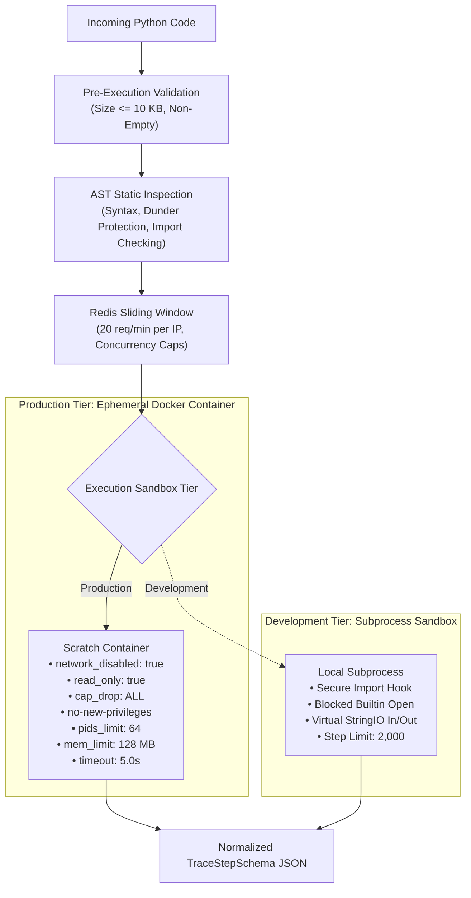

# CodeTrace Security Policy & Sandbox Architecture

CodeTrace executes untrusted user-submitted Python code in an isolated multi-ring sandbox environment. This document describes our security guarantees, defense-in-depth architecture, and vulnerability reporting procedures.

---

## 1. Multi-Ring Defense-in-Depth Architecture

---

## 2. Standard Library Allowlist (21 Permitted Modules)

Only safe, pure computational standard library modules may be imported. Any attempt to import unlisted modules is blocked before bytecode execution.

### Permitted Modules
1. `math` & `cmath`: High-performance mathematical and complex arithmetic functions.
2. `random`: Deterministic pseudo-random number generators.
3. `collections`: Specialized container datatypes (`defaultdict`, `Counter`, `deque`, `OrderedDict`, `namedtuple`).
4. `itertools`: Memory-efficient looping and combinatorics helpers (`combinations`, `permutations`, `cycle`, `islice`).
5. `heapq`: Binary min-heap algorithm implementation (`heappush`, `heappop`, `heapify`).
6. `bisect`: Bisection algorithms for binary search on sorted lists (`bisect_left`, `insort`).
7. `functools`: Higher-order functions and operations on callable objects (`cache`, `lru_cache`, `reduce`).
8. `string`: Common string operations, ascii constants, and templates.
9. `re`: Regular expression matching operations.
10. `typing`: Type hinting annotations and type constructor primitives.
11. `dataclasses`: Automatic boilerplate generation for data classes (`@dataclass`).
12. `copy`: Shallow and deep copying operations (`copy`, `deepcopy`).
13. `json`: JSON encoding and decoding.
14. `datetime`: Date and time manipulation objects (`datetime`, `date`, `timedelta`).
15. `time`: Pure monotonic time measurements (`monotonic`, `perf_counter`).
16. `enum`: Support for enumerations (`Enum`, `IntEnum`).
17. `queue`: Multi-producer, multi-consumer queues (`Queue`, `LifoQueue`, `PriorityQueue`).
18. `array`: Space-efficient arrays of basic numeric values.
19. `fractions`: Rational number arithmetic.
20. `statistics`: Mathematical statistics functions (`mean`, `median`, `stdev`).
21. `io`: Pure in-memory stream virtualization (`StringIO`).

### Blocked Modules & Functions
- **Operating System & Shell**: `os`, `sys`, `posix`, `nt`, `subprocess`, `shutil`
- **Networking**: `socket`, `urllib`, `requests`, `http`, `ftplib`, `ssl`
- **Dynamic Code Execution**: `eval`, `exec`, `__import__`, `importlib`
- **Filesystem Access**: `builtins.open`, `pathlib`, `tempfile`
- **Introspection Abuse**: `__subclasses__`, `__globals__`, `__code__`, `sys.modules`

---

## 3. Resource Boundaries & Ceilings

| Parameter | Limit | Enforcement Mechanism |
| :--- | :--- | :--- |
| **Source Code Size** | 10 KB (10,240 bytes) | Pre-execution AST validator |
| **Max Trace Steps** | 2,000 steps | `sys.settrace` step counter |
| **Standard Output** | 64 KB (65,536 bytes) | Virtualized in-memory buffer |
| **Execution Wall Time** | 5.0 seconds | Host process timer / container kill |
| **Container Memory** | 128 MB RAM (swap disabled) | Linux cgroups `memory.max` |
| **Container CPU** | 0.5 vCPU core quota | Linux cgroups `cpu.max` |
| **Process Table** | 64 PIDs | Linux cgroups `pids.max` |

---

## 4. Reporting Security Vulnerabilities

We welcome responsible security disclosures. If you discover a security boundary bypass, sandbox breakout, or resource leak:
1. Please **do not** open a public GitHub issue.
2. Email full reproduction steps and proof-of-concept code to: **`samirangit2006@gmail.com`**.
3. We acknowledge reports within 48 hours and work with reporters on responsible coordinated disclosures.
